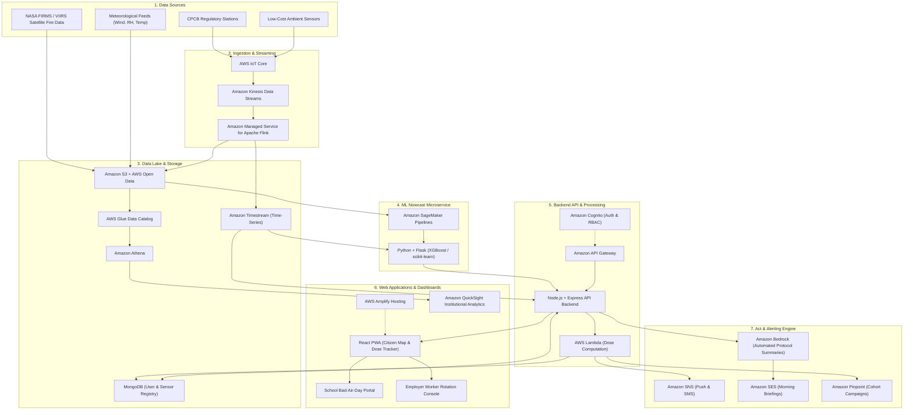

# Saans — Hyperlocal Air Intelligence

> Know your air. Protect the exposed. Act on bad days.

**Track:** AWS Hackathon — Track 01: Air ("Help people breathe easier.")

Saans turns one city-wide AQI into a street-level air-quality nowcast, a personal exposure score, and automatic bad-air-day alerts for the people most at risk.

---

## Overview

"Saans" means "breath". In urban centers across South Asia, official monitoring stations report a single, aggregated Air Quality Index (AQI) number for an entire metropolitan region. However, air quality varies block by block, and human exposure is deeply individualized.

Saans bridges the gap between macro atmospheric observations and human-level protection by transforming disparate environmental telemetry into street-level resolution, personal inhaled pollution calculations, and automated institutional safeguards.

---

## Problem Statement

Most people in India see only a single city-wide AQI number, but exposure to air pollution is personal — it depends on where you are, for how long, and how hard you are breathing. A delivery rider on a main road, a child at outdoor recess, and an office worker behind a purifier all read the same index and share none of the same air. 

The health cost is large: across ten major Indian cities, PM2.5 above the WHO limit was linked to roughly 33,000 deaths a year — 7.2% of all deaths, with Delhi highest at 11.5%. (Source: Lancet Planetary Health, 2024.)

---

## The Solution: Three Layers

Saans operates across three functional layers:

```
[ Sense: Street-Level Telemetry ] 
               │
               ▼
[ Score: Personal Exposure Dose ]
               │
               ▼
[ Act: Automated Safeguard Engine ]
```

### 1. Sense: Hyperlocal Environmental Nowcast
Constructs a street-level (100 m–1 km) air-quality nowcast updated continuously. The layer synthesizes data from:
* Central Pollution Control Board (CPCB) reference-grade monitoring stations.
* Distributed low-cost IoT particulate sensors.
* Satellite thermal anomaly and fire observation streams (NASA FIRMS / VIIRS).
* Micro-meteorological variables (wind vector, temperature, relative humidity, boundary layer height).

### 2. Score: Personal Inhaled Exposure Metric
Quantifies the cumulative pollutant burden an individual inhales throughout the day rather than static outdoor concentration.
* Incorporates precise spatiotemporal trajectories, dwell duration, and activity-adjusted inhalation rates (e.g., resting, walking, cycling, active labor).
* Computes real-time cleaner alternative routes and lower-risk departure windows to reduce acute inhalation spikes.

### 3. Act: Automated Bad-Air-Day Action Engine
Translates analytical thresholds into operational protocols and automated alerts:
* **Schools:** Automated triggers for indoor recess schedules, HVAC filter mode activation, and athletic event postponements.
* **Employers & Fleet Operators:** Shift rotation alerts for outdoor delivery riders and street workers when localized thresholds are exceeded.
* **Early Warning:** Predictive downwind stubble-burning plume arrival notices before regional sensor spikes manifest.

---

## Target Audience

Saans is designed for individuals at elevated exposure risk and the organizations responsible for their safety:

* **Schoolchildren and Educational Institutions:** School administrators, teachers, and physical education directors managing daily campus activity protocols.
* **Outdoor and Gig Workers:** Delivery personnel, logistics dispatchers, municipal field workers, and construction personnel facing continuous ambient exposure.
* **Parents and Caregivers:** Families protecting infants, children, and elderly dependents requiring actionable morning and commute planning.
* **Enterprise Health and Safety Managers:** Operations teams managing labor compliance, mask distribution, and duty-cycle rotations on high-pollution days.

---

## Key Features

* **Hyperlocal Nowcast Map:** Real-time 100 m to 1 km resolution interpolation combining CPCB telemetry, ambient IoT sensors, and weather vectors.
* **Personal Dose Tracker:** Activity-calibrated inhalation dose tracker computing actual microgram PM2.5 intake based on commute and physical exertion.
* **Clean-Route Suggestions:** Navigation routing engine that optimizes for lowest cumulative particulate exposure rather than merely shortest travel distance.
* **School Bad-Air-Day Dashboard:** Actionable administrative console that automates recess decisions, gym class relocations, and parent advisories.
* **Worker Rotation Alerts:** Automated supervisor dispatch and worker notifications enforcing mandatory rest cycles and protective gear deployment during peak road-edge spikes.
* **Stubble-Plume Early Warning:** Forward-looking smoke plume arrival forecasting powered by NASA FIRMS satellite fire detections and atmospheric transport models.
* **Indoor-Air Guidance:** Empirical filtration and ventilation advice calculated from outdoor ambient pressure, indoor occupancy, and building envelope characteristics.

---

## Tech Stack

| Component | Technology | Description |
| :--- | :--- | :--- |
| Frontend | React (PWA) | Mobile-responsive Progressive Web App built with React and standard CSS |
| App Backend & API | Node.js + Express | RESTful API server handling business logic, routes, and alerting coordination |
| Primary Database | MongoDB | Document store for user profiles, IoT sensor metadata, and daily dose records |
| ML Microservice | Python + Flask | Dedicated microservice for spatial downscaling and plume trajectory inference |
| Machine Learning | scikit-learn / XGBoost | Gradient boosted trees and spatial regression models for 100 m–1 km downscaling |
| Cloud Infrastructure | Amazon Web Services (AWS) | End-to-end serverless, ingestion, storage, machine learning, and notification services |

---

## AWS Usage

### AWS Open Source Technologies

Saans leverages managed open source frameworks and open source AWS development tooling:

* **Apache Flink (Amazon Managed Service for Apache Flink):** Stateful stream processing for rolling temporal sensor averages and anomaly detection.
* **Amazon OpenSearch Service:** Geospatial search indexing and fast spatial-temporal bounding box queries across sensor observations.
* **AWS Cloud Development Kit (AWS CDK):** Infrastructure as Code (IaC) defining reproducible cloud topologies in TypeScript.
* **AWS Amplify Framework:** Client-side libraries for seamless authentication flows, API Gateway integration, and progressive web app deployment.
* **AWS IoT Greengrass:** Edge runtime for local data validation, aggregation, and intermittent connectivity caching on field gateways.
* **Apache Airflow (Amazon Managed Workflows for Apache Airflow - MWAA):** Scheduled orchestration for satellite ingestion pipelines (NASA FIRMS) and model retraining jobs.

### AWS Cloud Architecture by Layer

| Layer | AWS Service | Purpose in Saans |
| :--- | :--- | :--- |
| **Sense** | AWS IoT Core | Secure MQTT telemetry ingestion from field sensors and low-cost IoT nodes |
| **Sense** | Amazon S3 + AWS Open Data | Data lake storage for raw telemetry, NASA FIRMS fire datasets, and weather archives |
| **Sense** | Amazon Timestream | Managed time-series database optimized for fast time-ordered sensor point retrieval |
| **Sense** | Amazon SageMaker | Training, hyperparameter tuning, and endpoint hosting for spatial downscaling models |
| **Sense** | Amazon Location Service | Map tiles, reverse geocoding, and pollution-aware route calculation |
| **Sense** | Amazon Kinesis / Managed Flink | Real-time sensor stream ingestion and continuous sliding-window anomaly detection |
| **Sense** | AWS Glue | Metadata cataloging and ETL transformation of heterogeneous pollution feeds |
| **Sense** | Amazon Athena | Interactive SQL queries directly over historical data lake partitions in Amazon S3 |
| **Score** | AWS Lambda | Serverless execution of dose calculations, activity weighting, and routing transformations |
| **Score** | Amazon DynamoDB / DocumentDB | Low-latency state store for live user session exposure counters and fast lookups |
| **Score** | Amazon Cognito | Secure user authentication, role-based access control (Parents, Schools, Employers) |
| **Act** | Amazon Simple Notification Service (SNS) | Multi-channel SMS and push delivery for rapid bad-air warnings |
| **Act** | Amazon Simple Email Service (SES) | Daily scheduled air-quality morning briefings and institutional reports |
| **Act** | Amazon Pinpoint | Targeted segment messaging based on geographic user cohorts and worker groups |
| **Act** | Amazon Bedrock | Generative AI synthesis of plain-language, role-specific safety protocols |
| **Act** | Amazon QuickSight | Business intelligence dashboards for school districts and municipal health monitors |
| **Hosting & Ops** | AWS Amplify Hosting | Global CDN hosting with automated CI/CD for the React web application |
| **Hosting & Ops** | AWS App Runner / Elastic Beanstalk | Managed container hosting for the Node.js API server and Flask ML microservice |
| **Hosting & Ops** | Amazon API Gateway | Managed REST API entry point with request throttling, authorization, and rate limiting |
| **Hosting & Ops** | Amazon CloudWatch | Application metrics, distributed trace logging, and infrastructure alarms |

---

## Architecture

The diagram below illustrates the end-to-end data flow: from distributed environmental inputs through stream ingestion, spatial modeling, backend aggregation, and real-time citizen and organizational safeguards.



---

## Repository Structure

```
Saans/
├── client/                     # React frontend (Progressive Web Application)
│   ├── public/                 # Static assets, manifests, icons
│   ├── src/
│   │   ├── components/         # Reusable UI components (Map, MetricCards, RoutePicker)
│   │   ├── pages/              # Views (Home, SchoolDashboard, WorkerPortal, DoseTracker)
│   │   ├── services/           # API clients and AWS Amplify bindings
│   │   ├── hooks/              # Custom React hooks (useGeolocation, useNowcast)
│   │   ├── App.jsx             # Main application component
│   │   ├── index.css           # Design tokens, layouts, and component styles
│   │   └── index.jsx           # React DOM root entry
│   └── package.json
│
├── server/                     # Node.js + Express application backend
│   ├── src/
│   │   ├── controllers/        # Route controllers (nowcast, dose, alerts, schools)
│   │   ├── models/             # Mongoose schemas (User, Sensor, DoseRecord, AlertRule)
│   │   ├── routes/             # Express API route declarations
│   │   ├── services/           # AWS service wrappers (SNS, SES, Location, Bedrock)
│   │   ├── middleware/         # Authentication and request validation middleware
│   │   └── server.js           # Express app bootstrap and listener
│   └── package.json
│
├── ml-service/                 # Python + Flask machine learning microservice
│   ├── app.py                  # Flask application entry point
│   ├── models/                 # Serialized XGBoost / scikit-learn model artifacts
│   ├── pipelines/              # Feature engineering, downscaling, and plume tracking
│   ├── requirements.txt        # Python package dependencies
│   └── Dockerfile              # Container configuration for AWS App Runner
│
├── infra/                      # AWS Cloud Development Kit (CDK) infrastructure
│   ├── bin/                    # CDK application entry point
│   ├── lib/                    # CDK stack definitions (IoT, Storage, Compute, Auth)
│   ├── cdk.json
│   └── package.json
│
├── docs/                       # Architectural diagrams and interface documentation
│   └── architecture.png
│
├── .env.example                # Canonical environment variable template
├── .gitignore                  # Git exclusions for Node, Python, and local artifacts
├── LICENSE                     # MIT License
└── README.md                   # Project documentation
```

---

## Getting Started

### Prerequisites

Ensure you have the following installed on your local development workstation:

* **Node.js** (v18.x or v20.x LTS) and **npm** (v9.x or later)
* **Python** (v3.10 or v3.11) and **pip**
* **MongoDB** (Local instance or MongoDB Atlas cluster connection URI)
* **Git** command line client
* *(Optional)* **AWS CLI** (configured with appropriate credentials for cloud deployment)

### 1. Clone the Repository

```bash
git clone https://github.com/your-username/Saans.git
cd Saans
```

### 2. Configure Environment Variables

Create `.env` configuration files for each component from the provided `.env.example` templates.

```bash
# Copy root environment template to service folders
cp .env.example server/.env
cp .env.example ml-service/.env
cp .env.example client/.env
```

Ensure placeholder parameters are populated with your development settings:

```env
# Application Server (server/.env)
PORT=5000
NODE_ENV=development
MONGODB_URI=mongodb://localhost:27017/saans
ML_SERVICE_URL=http://localhost:8000
AWS_REGION=ap-south-1
COGNITO_USER_POOL_ID=ap-south-1_placeholder
COGNITO_CLIENT_ID=placeholder_client_id
AWS_ACCESS_KEY_ID=placeholder_access_key
AWS_SECRET_ACCESS_KEY=placeholder_secret_key

# ML Microservice (ml-service/.env)
PORT=8000
FLASK_ENV=development
AWS_REGION=ap-south-1
TIMESTREAM_DATABASE=saans_telemetry
S3_BUCKET_NAME=saans-data-lake-placeholder

# Frontend Client (client/.env)
REACT_APP_API_BASE_URL=http://localhost:5000/api
REACT_APP_AWS_REGION=ap-south-1
REACT_APP_COGNITO_USER_POOL_ID=ap-south-1_placeholder
REACT_APP_COGNITO_WEB_CLIENT_ID=placeholder_client_id
```

### 3. Install Dependencies and Run Locally

#### Step A: Machine Learning Microservice

In a separate terminal window:

```bash
cd ml-service
python -m venv venv

# Windows:
venv\Scripts\activate
# macOS/Linux:
# source venv/bin/activate

pip install -r requirements.txt
python app.py
```
*The ML microservice starts on `http://localhost:8000`.*

#### Step B: Application Backend Server

In a second terminal window:

```bash
cd server
npm install
npm run dev
```
*The Express API backend starts on `http://localhost:5000`.*

#### Step C: Frontend Web Application

In a third terminal window:

```bash
cd client
npm install
npm start
```
*The React application starts on `http://localhost:3000`.*

---

## Roadmap

* **Native Mobile Applications:** Develop dedicated iOS and Android clients with background location sampling for passive personal exposure auditing.
* **Geographic Expansion:** Extend high-resolution downscaling grids from initial pilot corridors to 25 major Tier-1 and Tier-2 urban zones across India.
* **Indoor Sensor Hardware Integration:** Establish plug-and-play BLE and Wi-Fi pairing protocols for consumer and commercial particulate counters.
* **Municipal Clean-Air Action Plan Integration:** Expose secure webhook APIs to integrate with city-level dynamic traffic routing, dust suppression fleets, and industrial curtailment schedules.

---

## Team

| Name | Role |
| :--- | :--- |
| Raza Alam | Solo participant — concept, design, full-stack development, ML model, AWS pipeline, documentation |

---

## License

This project is licensed under the MIT License — see the [LICENSE](LICENSE) file for details.

---

## Acknowledgements

Built with data and research contributions from the Central Pollution Control Board (CPCB), NASA FIRMS, the Lancet Planetary Health research consortium, and the AWS Hackathon initiative.
